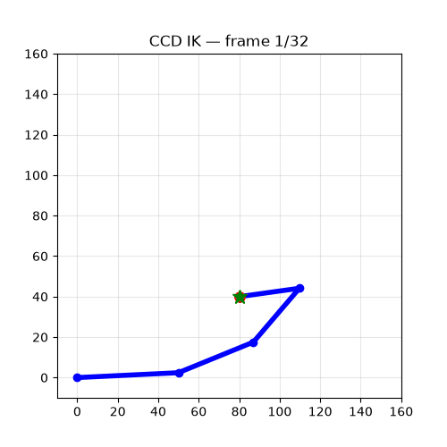

<p align="center">
  
</p>

<h1 align="center">🦾 CCD Inverse Kinematics — 2D Planar Arm</h1>

<p align="center">
  <a href="https://github.com/ekorudiawan/CCD-Inverse-Kinematics-2D"></a>
  <a href="https://www.python.org"></a>
  <a href="https://github.com/ekorudiawan/CCD-Inverse-Kinematics-2D/blob/master/LICENSE"></a>
</p>

**Cyclic Coordinate Descent (CCD)** Inverse Kinematics for an n-link planar arm,
implemented in pure Python with Matplotlib visualization.

Click anywhere on the canvas → the arm reaches that point in real time.

---

## Features

| What | How |
|------|-----|
| **n-link CCD IK solver** | Iterates from outermost joint inward |
| **Pure Python** | No ROS, no MATLAB, no proprietary deps |
| **Real-time interactive** | Click to set target, arm auto-solves |
| **CLI** | `ccd-ik` demo + GIF generation |
| **Animated GIF** | Batch IK solving across multiple targets |

## Quick start

```bash
pip install -r requirements.txt
pip install -e ".[gif]"

# Print IK results for a few targets
ccd-ik

# Generate animated GIF
python scripts/generate_demo.py gif
```

Or in Python:

```python
from ccd_ik.kinematics import FK, IK
import numpy as np

links = [50, 40, 35, 30]
angles = [0.0, 0.0, 0.0, 0.0]
target = np.array([80.0, 40.0, 0.0])

result = IK(target, angles, links)
P = FK(result.angles, links)
ee = P[-1][:3, 3]

print(f"solved={result.solved}, err={result.error:.4f}")
print(f"end-effector at ({ee[0]:.1f}, {ee[1]:.1f})")
```

## How it works

**CCD** is a heuristic IK solver that processes joints from the **outermost** (end-effector)
to the **innermost** (base). For each joint:

1. Compute the vector from that joint to the current end-effector.
2. Compute the vector from that joint to the target.
3. Calculate the rotation angle that aligns these two vectors.
4. Update the joint angle and repeat.

This converges monotonically — no matrix inversion, no Jacobians, no singularities
in the typical sense.

### Project structure

```
CCD-Inverse-Kinematics-2D/
├── ccd_ik/                     # Python package
│   ├── __init__.py
│   └── kinematics.py           # FK(), IK() — core algorithm
├── scripts/generate_demo.py    # GIF generation + CLI
├── images/
│   ├── animation.gif           # Original GIF
│   └── ccd_ik.gif              # New automated GIF
├── sources/
│   └── CCD-Inverse-Kinematics-2D.py   # Original interactive script
├── pyproject.toml
├── requirements.txt
└── .github/workflows/ci.yml
```

## Changelog

### v2.0.0 (2026)

- **`ccd_ik` package** — clean API with `FK()`, `IK()`, `IKResult` dataclass
- Fixed `math.inf` → `float("inf")` bug
- CLI + GIF generation
- GitHub Actions CI
- MIT license

### v1.0

- Original interactive Matplotlib implementation
